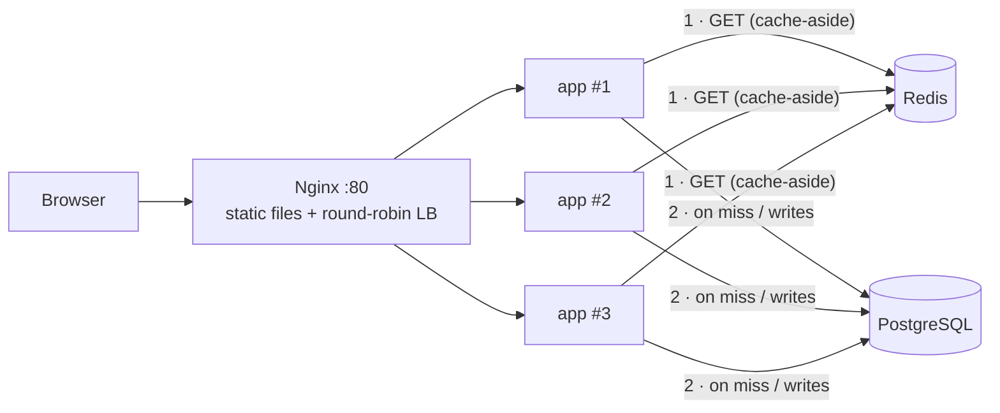

# Scalable Task Board: Load Balancing + Redis Cache

**A Node.js API scaled horizontally to 3 instances behind an Nginx load balancer, with a Redis cache-aside layer in front of PostgreSQL and graceful fallback when Redis is down.**


> **ENGSE207 Software Architecture, Week 6 lab.** Part of a series that evolves one task board: [layered](https://github.com/tawan230666/engse207-week4-layered) → [N-tier](https://github.com/tawan230666/engse207-task-board) → **load-balanced + cache** → [event-driven](https://github.com/tawan230666/week7_lab_event_driven_rabbitmq) → [secured microservices](https://github.com/tawan230666/engse207-termproject-jwt-microservices).

## Architecture



## What it demonstrates

- **Stateless horizontal scaling.** `docker compose up --scale app=3`. Docker DNS resolves `app` to every instance and Nginx round-robins across them. The `X-Served-By` response header and the `instanceId` in `/api/health` show which instance answered.
- **Cache-aside pattern.** Reads check Redis first. On a miss they query PostgreSQL and populate the cache. Any create, update or delete invalidates the affected keys (task list, task by ID, stats), so reads never serve stale data after a write.
- **Graceful degradation.** If Redis is unavailable the API keeps working straight from PostgreSQL ("degraded mode") instead of failing.
- **Observability.** `/api/health` reports database and Redis status plus live cache hits, misses and hit rate per instance.

## Run it

```bash
git clone https://github.com/tawan230666/Week6_lab_ntier_redis_loadbalance.git
cd Week6_lab_ntier_redis_loadbalance
docker compose up -d --build --scale app=3
```

Open http://localhost, then see load balancing and caching in action:

```bash
# Different instances answer successive requests
for i in 1 2 3 4 5 6; do curl -s http://localhost/api/health | jq -r .instanceId; done

# First call is a cache MISS, repeats are HITs — watch the hit rate climb
for i in 1 2 3 4 5; do curl -s -o /dev/null http://localhost/api/tasks; done
curl -s http://localhost/api/health | jq .cache

# Stop Redis: the API keeps serving from PostgreSQL
docker compose stop redis && curl -s http://localhost/api/tasks | jq .count
```

| Method | Endpoint |
|---|---|
| `GET` | `/api/tasks`, `/api/tasks/:id`, `/api/tasks/stats` |
| `POST` | `/api/tasks` |
| `PUT` / `DELETE` | `/api/tasks/:id` |
| `GET` | `/api/health` (instance ID, DB/Redis status, cache stats) |

## Project structure

```
api/        Express API: routes → controllers → services → repositories, Redis + DB config
nginx/      Load balancer and static file server
frontend/   Task board UI
database/   Schema and seed data
```

---

**Author:** Tawan Tiphkun ([@tawan230666](https://github.com/tawan230666)), Software Engineering, RMUTL Chiang Mai
